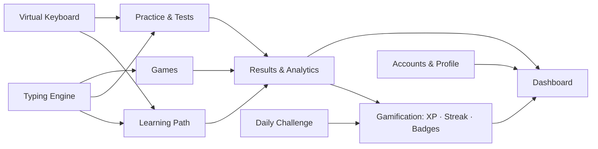

# 02 · Feature Breakdown

Legend — **Priority:** M = Must-have · S = Should-have · N = Nice-to-have. **Release:** MVP = v1.0, or later version.

## Module map

## Modules

### M1 · Accounts & Profile
- **Purpose:** identity, persistence, preferences.
- **Functionality:** email/password + Google sign-in, guest trial (progress is saved to local storage, merged on sign-up), profile, goals, settings (sound, text size, theme, keyboard layout).
- **Interactions:** sign up → pick goal (“Learn from scratch / Get faster / Practice”) → placement test (optional).
- **Dependencies:** none (foundation). **Priority:** M · **Release:** MVP.
- Nice-to-have later: avatar upload (N, v1.1), delete-account/export data (S, MVP — GDPR), classroom (N, v2.2).

### M2 · Typing Engine (shared core)
- **Purpose:** one accurate, fast input/measurement layer for every surface.
- **Functionality:** keystroke capture with timestamps, correct/incorrect state per character, backspace rules (strict vs forgiving), WPM (net, 5-char word), accuracy, consistency, error map per key.
- **Dependencies:** none. **Priority:** M · **Release:** MVP.

### M3 · Learning Path
- **Purpose:** structured skill building from zero.
- **Functionality:** units → lessons; each lesson = keys intro → drill → words → mini test; pass gate = accuracy ≥ 90% (Beginner) / ≥ 95% (Adv). Stars (1–3) per lesson. Unlocks sequentially.
- **User interactions:** pick lesson, type, retry, skip-ahead via placement test.
- **Dependencies:** M2, M4. **Priority:** M · **Release:** MVP (Beginner 12 + Intermediate 8); Advanced content v1.3.
- Beginner: home row → top row → bottom row → numbers. Intermediate: capitals, punctuation, common words, sentences. Advanced: paragraphs, code/symbols, numbers-heavy, speed bursts.

### M4 · Virtual Keyboard & Finger Guide
- **Purpose:** teach finger placement; show where errors happen.
- **Functionality:** on-screen QWERTY, finger colour zones, next-key highlight, keypress feedback, toggle off; heatmap overlay on Progress.
- **Dependencies:** M2. **Priority:** M · **Release:** MVP. (Heatmap overlay: S, MVP.)

### M5 · Practice & Tests
- **Purpose:** free typing and benchmark tests.
- **Functionality:** modes — Time (15/30/60/120s), Words (10/25/50), Quote, Custom text (N, later); options — punctuation, numbers; restart shortcut (Tab+Enter), live WPM/accuracy.
- **Dependencies:** M2, M4. **Priority:** M · **Release:** MVP (Time + Words). Quote S v1.1, Custom N v1.4.

### M6 · Results & Analytics
- **Purpose:** turn raw sessions into insight and the next action.
- **Functionality:** result card (WPM, accuracy, consistency, time, errors), WPM-over-time chart, problem keys, “Practice weak keys” CTA, personal best detection; Progress page with trends (7/30/90 d), weak-key heatmap, time practiced, history table.
- **Dependencies:** M2, M5/M3/M7. **Priority:** M (result card + basic trend) · S (heatmap, bigram analysis).
- **Release:** MVP (result, trend, weak keys); bigram/finger-load analytics v1.2.

### M7 · Games
- **Purpose:** low-pressure repetition with fun.
- **Functionality:** *Word Rush* (type words before timer, combo multiplier) — MVP; *Falling Words* (type words before they land) — v1.1; *Typing Racer* (race ghosts/bots) — v1.2, realtime humans v2.0.
- **Dependencies:** M2, M8. **Priority:** S (one game) / N (others). **Release:** see above.
- **Rule:** every game reports the same stats to Results (WPM/accuracy/keys) so it counts toward progress.

### M8 · Gamification (XP, Streak, Badges, Daily Challenge)
- **Purpose:** habit formation without noise.
- **Functionality:** XP per completed lesson/test/game (accuracy-gated), levels, daily streak with 1 freeze/week, badges (first lesson, 7-day streak, 50 WPM, 98% accuracy, …), Daily Challenge (one fixed text for all users, day-keyed).
- **Dependencies:** M2, M6. **Priority:** S (XP/streak/badges) · N (daily challenge). **Release:** MVP for XP/streak/12 badges; Daily Challenge v1.1.

### M9 · Public Website
- **Purpose:** acquisition and instant value.
- **Functionality:** landing page with an *embedded 30-second guest test* (no sign-up), feature overview, FAQ, legal. **Priority:** M · **Release:** MVP.

## Prioritised summary
| Priority | Features |
|---|---|
| **Must-have (MVP)** | Auth, profile basics, typing engine, Beginner+Intermediate lessons, practice/time tests, results, virtual keyboard, dashboard, landing |
| **Should-have (MVP if capacity, else v1.1)** | Progress analytics + weak-key heatmap, XP/streak/badges, Word Rush, settings (sound/text size) |
| **Nice-to-have (post-MVP)** | Falling Words, Racer, Daily Challenge, leaderboards, custom text, code mode, avatars, i18n/layouts, classroom |

## Complexity watch-list (don't over-build)
- Realtime multiplayer (needs websockets, matchmaking, anti-cheat) → **v2.0**.
- Adaptive lesson generation → start with **static curated lessons + weak-key drill generator**, not ML.
- Multiple keyboard layouts → data-driven keymap but ship QWERTY only.
