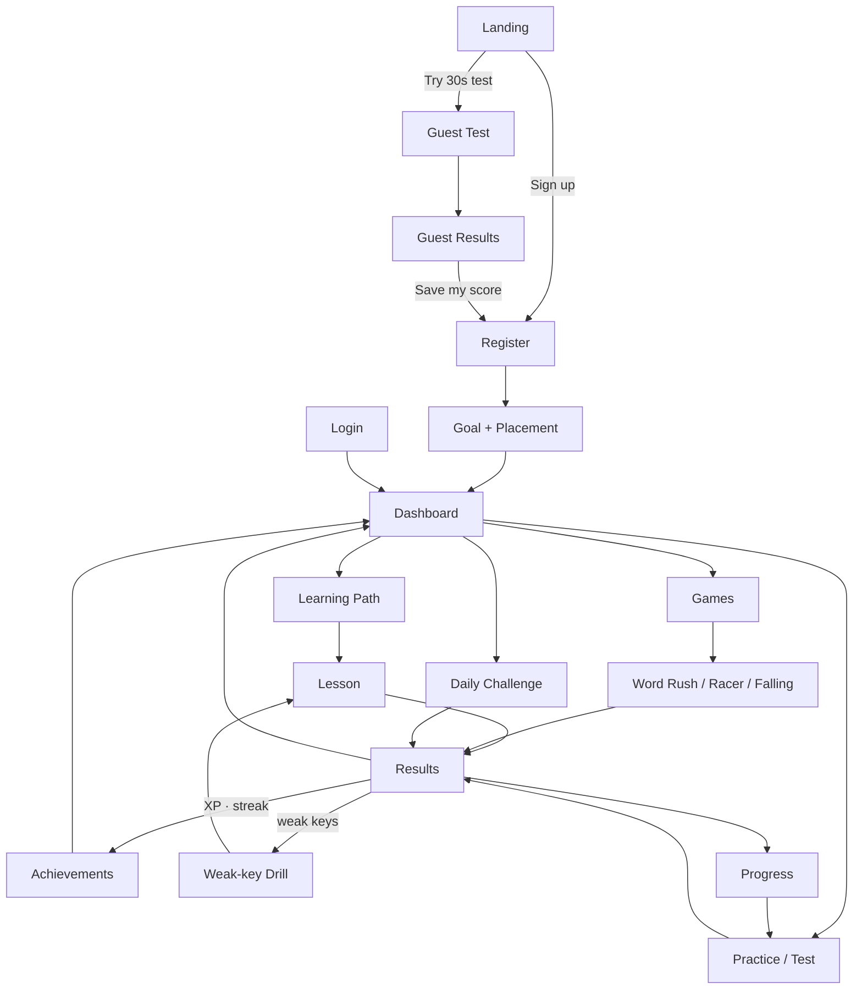
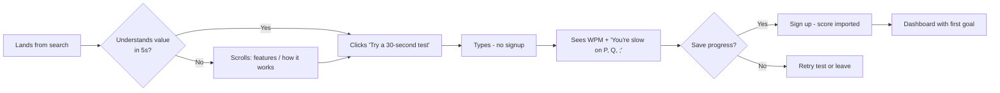
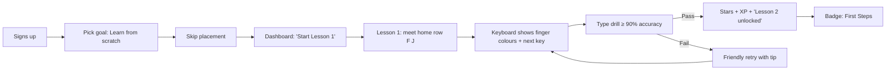
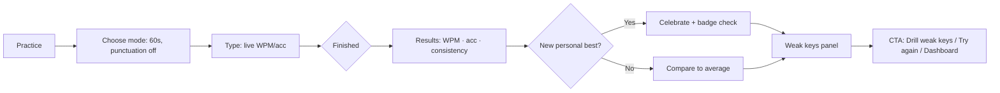
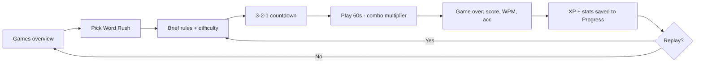
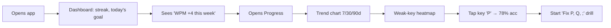
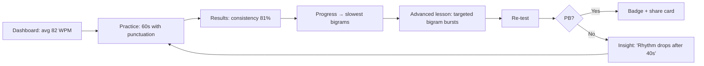

# 03 · User Journeys & Application Flow

## 0 · Master flow — how everything connects

## 1 · First-time visitor

**Success:** test completion rate ≥ 50%; sign-up conversion from results ≥ 20%.

## 2 · Beginner starting their first lesson

## 3 · Completing a practice session

## 4 · Playing a typing game

## 5 · Returning user checking progress

## 6 · Advanced user improving speed

## Navigation rules
- Primary nav (always visible once signed in): **Dashboard · Learn · Practice · Games · Progress · Achievements**; Profile via avatar menu.
- Every **Results** screen offers exactly three next actions: *Primary* (recommended drill), *Retry*, *Back to dashboard*.
- Leaving a running session asks for confirmation; stats from abandoned sessions < 10 s are discarded.
