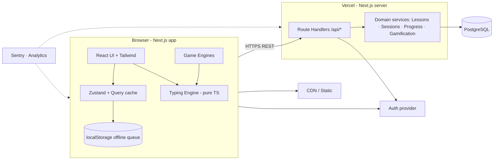
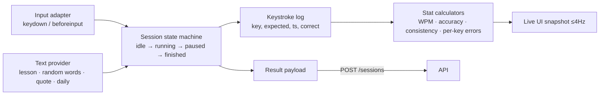
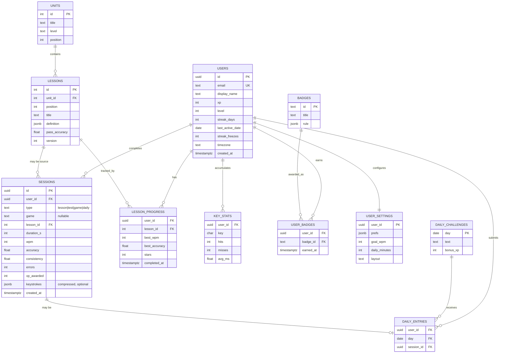
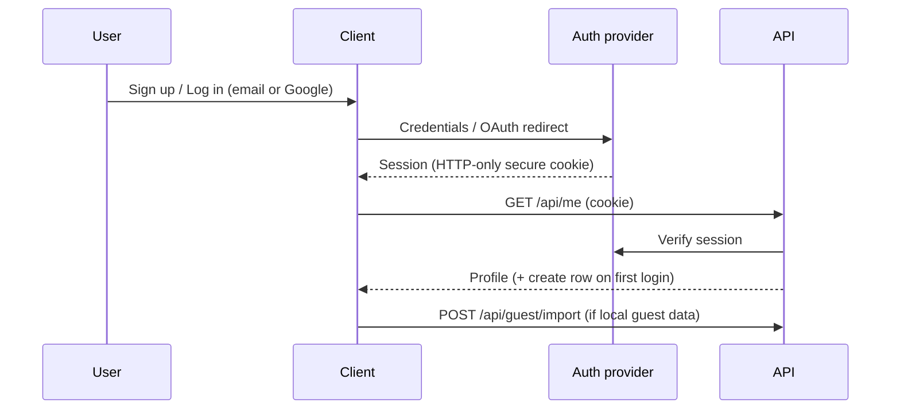
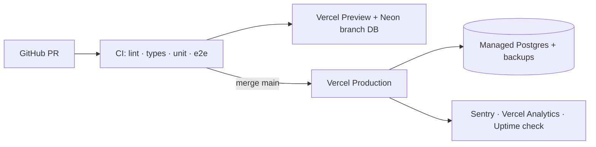

# 07 · Technical Architecture (proposal — nothing implemented)

## 1. Key decisions & trade-offs
| Area | Recommendation | Alternative | Why / trade-off |
|---|---|---|---|
| Framework | **Next.js (App Router) + TypeScript** | Vite SPA + separate API | One codebase, SSR/SEO for the public site, API routes for backend. Cost: less backend isolation; fine until scale. |
| Styling | **Tailwind CSS + CSS variables (design tokens)** + Radix primitives | CSS-in-JS | Tokens make Minimal/Dark themes trivial (prototype already works this way). |
| State | **Zustand** for engine/session state; **TanStack Query** for server data | Redux | Light, fast re-render control for the typing loop. |
| Backend | **Next.js Route Handlers** (REST+Zod) | NestJS / Fastify | Fewer moving parts for MVP; extract to a service later if multiplayer needs websockets. |
| Database | **PostgreSQL** (managed, e.g. Supabase/Neon) | MongoDB | Relational data (users, lessons, attempts, progress) with aggregation needs. |
| ORM | **Drizzle** (or Prisma) | raw SQL | Type-safe migrations. |
| Auth | **Supabase Auth / Auth.js** — email+password, Google OAuth, HTTP-only cookie sessions | Custom JWT | Don't roll our own; secure defaults. |
| Charts | **Recharts** or lightweight SVG | D3 | Fast to build; prototype charts are plain SVG. |
| Games | DOM/CSS for Word Rush; **Canvas/rAF** for Falling Words/Racer | Phaser | No heavy engine needed. |
| Realtime (v2.0) | Websocket service (Supabase Realtime/Ably/PartyKit) | Self-hosted WS | Deferred; design keeps engine transport-agnostic. |
| Persistence | **Server is source of truth; localStorage queue for offline/guest** | Server only | Resilient to flaky connections; guest scores merge on sign-up. |

## 2. System architecture


## 3. Typing engine architecture
A **framework-free TypeScript package** (`packages/typing-engine`) so lessons, tests and games share it and it's unit-testable without a DOM.

- **WPM** = (correct chars ÷ 5) ÷ minutes. **Accuracy** = correct keystrokes ÷ total keystrokes. **Consistency** = 1 − coefficient of variation of per-second WPM.
- Rules (configurable): forgiving vs strict backspace, stop-on-error off by default.
- Engine emits events; React subscribes with a ref/`useSyncExternalStore` so only the stat row and current-char re-render (no full text re-render per key).
- Server validates results (plausible WPM ceiling, keystroke timing variance) before awarding XP — light anti-cheat.

## 4. Lesson management
Lessons are **data, not code**: JSON/YAML in repo (`content/lessons/*.json`) seeded into DB, versioned. Fields: id, unit, order, level, title, new keys, step definitions (drill/words/sentences/test), pass criteria, text generators (seeded random from key set). Weak-key drill = generator with weights from user's error map. Unlock logic: lesson N unlocks when N‑1 passed.

## 5. Game engine architecture
Common interface: `Game { init(config), start(), onInput(word|char), tick(dt), result() }`, all consuming the typing engine; each game returns the **same Result payload** so Progress/XP are unified. Word Rush = state machine + timer; Falling Words = rAF loop with spawn scheduler; Racer = ghost replay of stored keystroke logs + bot speed curves (no network needed in MVP).

## 6. Progress tracking & gamification
- Each finished activity → `sessions` row + per-key aggregate update (`key_stats`) in the same transaction.
- XP: `base(activity) × accuracyMultiplier`, only if accuracy ≥ gate. Level = f(total XP) (e.g., 100×n^1.5).
- Streak: computed from distinct practice days in user's timezone; 1 freeze/week stored on user.
- Badges: rule table evaluated after each session (`badge_rules` → idempotent `user_badges` insert).
- Daily challenge: deterministic text from `date` seed; leaderboard is v1.1.

## 7. Database design — ERD

Indexes: `sessions(user_id, created_at desc)`, `key_stats(user_id, key)` PK, `lesson_progress(user_id, lesson_id)` PK. Row-level security so users only read/write their own rows.

## 8. API structure (REST, JSON, Zod-validated)
| Method | Endpoint | Purpose |
|---|---|---|
| POST | `/api/auth/register` · `/login` · `/logout` | Email auth (or delegated to provider) |
| GET/PATCH | `/api/me` | Profile, XP, streak |
| GET/PATCH | `/api/me/settings` | Preferences |
| GET | `/api/path` | Units + lessons + user progress |
| GET | `/api/lessons/:id` | Lesson definition + generated text |
| POST | `/api/sessions` | Submit finished session → returns result, XP, new badges, unlocks |
| GET | `/api/sessions?range=30d&cursor=` | History |
| GET | `/api/stats/summary?range=` | Aggregates for dashboard/progress |
| GET | `/api/stats/keys` | Per-key accuracy/speed |
| GET | `/api/drill/weak-keys` | Generated weak-key drill text |
| GET | `/api/badges` | All + earned |
| GET | `/api/daily` · POST `/api/daily/submit` | Daily challenge (v1.1) |
| POST | `/api/guest/import` | Merge guest local results after sign-up |
| DELETE | `/api/me` · GET `/api/me/export` | Account deletion / data export |

## 9. Authentication flow

Security: HTTP-only SameSite cookies, CSRF protection on mutations, rate limits on auth, password rules + breach check, Zod validation everywhere, RLS in DB.

## 10. Frontend structure & project layout (monorepo)
```
typemaster/
├─ docs/                       # planning (this folder)
├─ apps/web/                   # Next.js app
│  ├─ app/(public)/            # landing, login, register, legal
│  ├─ app/(app)/               # authenticated: dashboard, learn, practice, games, progress, ...
│  ├─ app/api/                 # route handlers
│  ├─ components/ui/           # design-system primitives (Button, Card, Tabs, Toggle...)
│  ├─ components/typing/       # TypingSurface, VirtualKeyboard, LiveStats
│  ├─ features/{lessons,games,progress,gamification}/
│  ├─ lib/{db,auth,api,utils}/
│  └─ styles/tokens.css        # theme tokens
├─ packages/typing-engine/     # pure TS + unit tests
├─ packages/content/           # lesson JSON + generators
├─ packages/db/                # schema, migrations, seed
└─ .github/workflows/          # CI
```
**Main dependencies:** next, react, typescript, tailwindcss, @radix-ui/*, zustand, @tanstack/react-query, zod, drizzle-orm (or prisma), recharts, framer-motion (sparingly), howler (optional sound), vitest, @testing-library/react, playwright, eslint, prettier.

## 11. Dev environment
Node 20 LTS, pnpm workspaces, Turborepo (optional), Docker Compose for local Postgres, `.env.example`, seed script, Husky + lint-staged.

## 12. Testing strategy
| Layer | Tool | Focus |
|---|---|---|
| Engine unit | Vitest | WPM/accuracy math, backspace modes, edge cases (fast typists, pauses) — **highest coverage (≥ 95%)** |
| Components | Testing Library | Typing surface states, keyboard highlighting |
| API | Vitest + test DB | Validation, XP/streak/badge rules, RLS |
| E2E | Playwright | Sign-up → lesson → results; guest test → sign-up import; mobile viewport |
| Visual | Playwright screenshots | Themes, key screens |
| A11y | axe, manual keyboard-only | Contrast, focus, screen-reader labels |
| Perf | Lighthouse CI, custom keystroke latency test | < 16ms render per key |

## 13. Deployment architecture

Environments: local · preview (per PR) · production. DB migrations run in CI before deploy; secrets in the host's env store.

## 13b. Data persistence strategy
- Guest: results in `localStorage` (versioned schema), merged at sign-up.
- Signed-in: write-through to server on session end; failed writes queued (IndexedDB/localStorage) and retried with backoff; UI shows "Saved / Syncing / Retry".
- Keystroke logs stored compressed and only for last N sessions (privacy + cost); aggregates kept forever.
