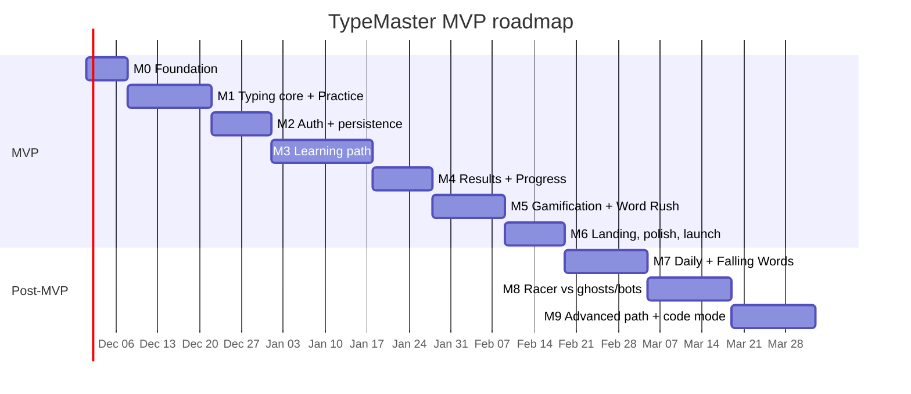

# 08 · Development Roadmap (proposal)

Order is chosen so there is a *usable typing product* as early as possible, then learning, then retention, then fun extras. Estimates assume 1–2 developers; adjust after approval.

## Milestones
### M0 · Foundation (≈1 wk)
- **Objective:** repo, tooling, design system skeleton.
- **Features:** monorepo, CI, theme tokens, UI primitives (Button, Card, Tabs, Toggle, Progress), app shell (sidebar / tab bar).
- **Dependencies:** approved design direction + stack.
- **Tasks:** scaffold; lint/test/CI; tokens from approved theme; shell + routing; Storybook (optional).
- **Deliverables:** deployed empty shell on preview URL.
- **Acceptance:** CI green; shell responsive at 390/768/1280; Lighthouse ≥ 95 on empty page.

### M1 · Typing core + Practice (≈2 wks)
- **Objective:** a working, accurate typing test (guest, no login).
- **Features:** typing engine package, TypingSurface, live stats, 15/30/60s modes, punctuation toggle, virtual keyboard, basic results card.
- **Dependencies:** M0.
- **Tasks:** engine + tests; text provider (word lists); surface component; keyboard component; restart/pause; results card.
- **Deliverables:** `/app/practice` and guest test on landing placeholder.
- **Acceptance:** engine ≥ 95% test coverage; WPM matches reference on 20 scripted inputs; no layout shift; keystroke render < 16 ms.

### M2 · Accounts & persistence (≈1.5 wks)
- **Objective:** save progress.
- **Features:** register/login/logout, Google OAuth, profile row, settings, session save API, guest import, offline queue.
- **Dependencies:** M1.
- **Tasks:** DB schema + migrations + RLS; auth; `/api/sessions`; settings page; guest merge.
- **Deliverables:** sign-up → practice → history persisted.
- **Acceptance:** E2E sign-up/login passes; guest score appears after sign-up; RLS test proves cross-user isolation; account delete/export work.

### M3 · Learning path (≈2.5 wks)
- **Objective:** structured Beginner + Intermediate curriculum.
- **Features:** units/lessons data, path overview, lesson player (4 steps), pass gates, stars, unlocking, finger-guide keyboard, tips on failure.
- **Dependencies:** M1, M2.
- **Tasks:** content authoring (12 + 8 lessons); lesson generator; lesson player; progress tracking API; path UI.
- **Deliverables:** 20 playable lessons.
- **Acceptance:** lesson N+1 unlocks only after pass; stars computed per spec; failing shows specific key tip; content reviewed by a typing-teacher.

### M4 · Results & Progress (≈1.5 wks)
- **Objective:** make performance visible and actionable.
- **Features:** full results screen, PB detection, weak-key drill generator, Progress page (trend, time, heatmap, history), dashboard.
- **Dependencies:** M2, M3.
- **Tasks:** per-key aggregates; stats endpoints; charts; dashboard; empty/loading/error states.
- **Deliverables:** dashboard + progress live with real data.
- **Acceptance:** aggregates match raw sessions in tests; drill text weights toward weak keys; all three states present per list screen.

### M5 · Gamification + Word Rush (≈2 wks)
- **Objective:** retention loop and first game.
- **Features:** XP/levels, streak (+freeze), 12 badges, achievements page, Word Rush, games overview.
- **Dependencies:** M4.
- **Tasks:** XP/badge rules service; streak calc with timezone; Word Rush game; unified result payload.
- **Deliverables:** achievements + playable game.
- **Acceptance:** XP only awarded above accuracy gate; streak correct across timezone/DST tests; badge awards idempotent.

### M6 · Landing, polish & launch (≈1.5 wks)
- **Objective:** public-ready MVP.
- **Features:** landing page with guest test, legal pages, a11y pass, perf pass, analytics, error monitoring, SEO.
- **Dependencies:** M1–M5.
- **Tasks:** landing; axe audit; keyboard-only run-through; Lighthouse; Sentry; beta with ~20 users.
- **Deliverables:** **MVP v1.0 in production.**
- **Acceptance:** Lighthouse ≥ 90 (mobile), zero critical axe issues, E2E suite green, beta feedback triaged.

## Post-MVP
| Release | Scope |
|---|---|
| **v1.1** | Daily challenge + leaderboard (today), Falling Words, Quote mode |
| **v1.2** | Typing Racer vs ghosts/bots, bigram analytics |
| **v1.3** | Advanced path (symbols, code), custom text |
| **v2.0** | Realtime multiplayer races, friends, global leaderboards |
| **v2.1+** | More keyboard layouts, classroom mode, PWA/offline, premium tier |

## Recommended build order rationale
Engine first (everything depends on it) → persistence (so every later feature produces durable data) → lessons (core value) → analytics (closes the learn→measure loop) → gamification (amplifies existing loop) → polish. Games and multiplayer come last because they add fun but not core learning value.
